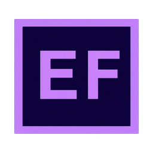
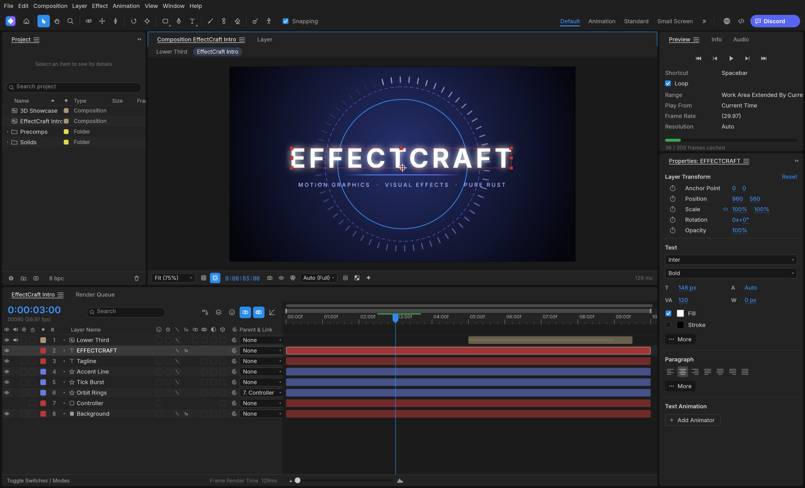
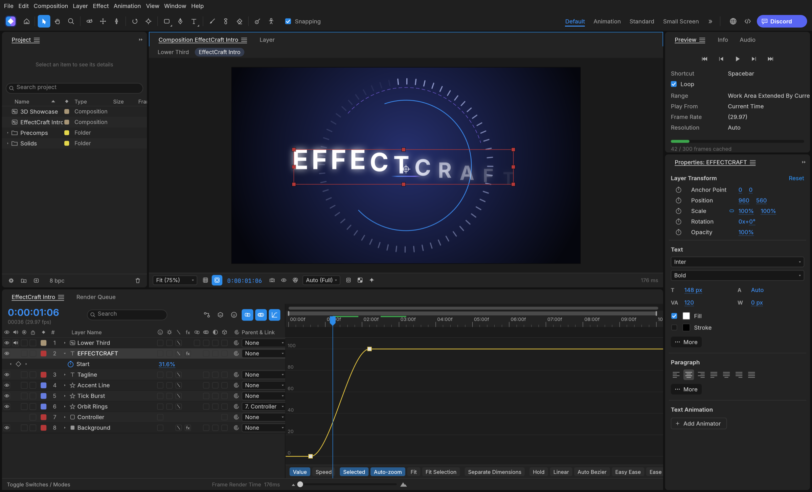
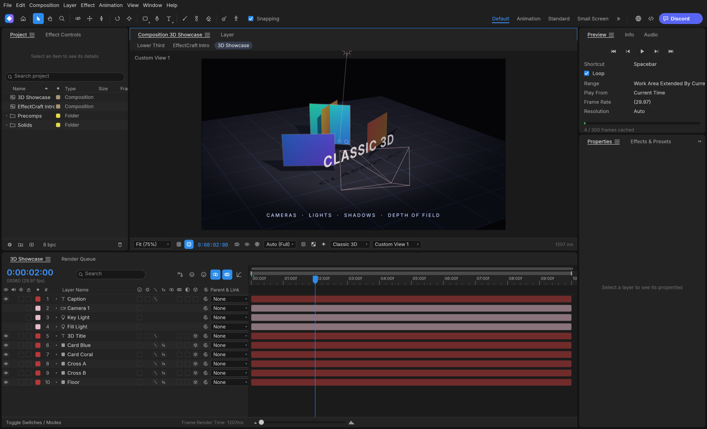

</br>
</br>
<p align="center">
  
</p>

<h1 align="center">EffectCraft</h1>

<p align="center">
  <b>Motion graphics and visual effects; an open-source, professional motion graphics and visual effects studio, built in pure Rust.</b>
</p>

<p align="center">
  A free, open-source compositor: compositions, layers,
  keyframes, 308 effects, layer styles, expressions, 3D cameras and lights, and a render queue, native on macOS,
  Windows and Linux, and in the browser. Young, moving fast, and already usable.
</p>

<p align="center">
  
  
  
  <br>
  
  
</p>

<p align="center">
  <b>EffectCraft on getartcraft.com</b> ·
  ArtCraft ·
  All Crafting Apps
</p>

<br>

<p align="center">
  
</p>

> [!NOTE]
> **ArtCraft is a community of artists from all walks of life.** Digital, generative, music,
> games &mdash; if you make things, you're one of us.

<p align="center">
  <a href="#what-effectcraft-is">What it is</a> ·
  <a href="#animate">Animate</a> ·
  <a href="#effects">Effects</a> ·
  <a href="#3d">3D</a> ·
  <a href="#export">Export</a> ·
  <a href="#built-for-agents">Agents</a> ·
  <a href="#get-started">Get started</a> ·
  <a href="#where-it-stands">Status</a> ·
  <a href="#how-its-made">How it's made</a> ·
  <a href="#downloads">Downloads</a> ·
  <a href="#the-crafting-apps">The Crafting Apps</a> ·
  <a href="#license-and-credits">License</a>
</p>

## What EffectCraft is

EffectCraft is for animated titles, motion graphics and compositing work: the kind of thing
motion designers and VFX artists need. You build a composition out of layers (solids, shapes,
text, footage, other compositions), animate their properties with keyframes, stack effects on
them and render the result.

The interface feels natural and responsive, with dedicated panels (Project, Composition, Timeline,
Layer, Footage, Effect Controls, Tools, Preview, Effects & Presets, Audio, Info, Paragraph,
Character, Align, Progress, Render Queue) and standard motion graphics shortcuts, going further in
a few places where it matters to us:

- **Lottie import and export built in**, so animations can go straight to the web and apps
  without a plugin.
- **A project file you can read.** Projects are versioned JSON (`.ecproj`), so they diff cleanly
  in version control.
- **Everything is scriptable.** Menu actions, timeline edits and property changes are exposed as
  commands. Engine commands are available through the CLI, JSON control channel and MCP;
  UI-only commands use the frontend dispatcher and can be invoked through the control channel
  or an attached MCP bridge.
- **No FFmpeg.** Video and audio decoding and encoding are pure Rust: FilmCraft's codecs and
  EffectCraft's own VP9, AV1, HEVC and Opus encoders.

## Animate

The panels, menus and shortcuts follow standard motion design conventions:
Project, Composition, Timeline, Effect Controls, Properties, Effects & Presets, Character,
Paragraph, Align, Info, Preview, Audio and the Render Queue, docked the way you expect. Drag
footage, comps and effects between them: onto the comp viewer, where they land under the pointer,
or into the Timeline, between layers and at the time you point to.

- **Layers of every kind:** solids, shapes, text, footage, nested compositions, nulls,
  adjustment layers, cameras and lights; parenting, track mattes, all 38 blend modes, motion blur.
- **Keyframes that behave the same:** linear, Bezier, hold, auto and continuous Bezier, roving
  keys, Easy Ease (F9), Keyframe Velocity and Interpolation dialogs, copy and paste at the current
  time, and a **Graph Editor** with value and speed graphs and draggable handles.
- **Time:** time remapping, time stretch, time-reverse, freeze frame, work area, markers, exact
  frame-accurate timing at every frame rate including 29.97 drop-frame.
- **Shapes and masks:** shape layers with trim paths, repeaters, round corners, offset, zig zag,
  twist, wiggle, merge paths and gradient strokes; masks drawn with the pen tool, with modes,
  feather, expansion and vertex editing in the viewer.
- **Text:** point and paragraph text with real shaping in any font installed on your machine, the
  Character and Paragraph panels, and text animators with range selectors.
- **Expressions:** JavaScript with the standard motion expressions model (`wiggle`, `loopOut`,
  `thisComp.layer("…")`, vector maths on arrays), an inline editor and the pick-whip.
- **Timeline like you know it:** twirl layers open to Transform, masks, effects and the rest; drag
  rows to reorder layers; rename with Enter or a double-click; the property shortcuts (A, P, S,
  R, T, M, F, E, L, U and their double presses AA, PP, SS, RR, TT, MM, FF, EE, LL, UU), Shift to
  add properties, Alt+Shift+A/P/S/R/T to key the current time, Ctrl+` to twirl selected layers.
- **Puppet tools:** Position, Advanced, Bend, Starch and Overlap pins on a mesh built from the
  layer, real-time pin recording, rotate/scale handles, pins driven by (or carrying) nulls for
  rigging, and follow-through for hair and cloth.

<p align="center">
  
</p>

## Effects

308 built-in effects across its categories, each with its parameter names, order and
defaults: blur and sharpen, channel, color correction (Curves, Levels, Hue/Saturation, a full
color-grading panel…), distort (Warp, Bulge, Turbulent Displace, Perspective Pin…), generate (Fractal Noise,
Gradient Ramp, Stroke, Write-on, Audio Spectrum…), keying, matte, noise and grain, perspective,
**simulation** (Particle Emitter 3D, Rainfall, Shatter, Card Dance, Caustics, Wave World…),
stylize (Glow, Glass Relief…), **time** (Echo, Posterize Time, Timewarp, Time Displacement…),
**audio** (Reverb, Parametric EQ, Delay, Stereo Mixer…), text, transitions, utility and expression
controls. All nine **Layer Styles** (Drop Shadow, Inner/Outer Glow, Bevel and Emboss, Satin,
overlays, Stroke) with Global Light. Preview plays audio in sync, with meters and waveforms.

## 3D

Classic 3D compositing: 3D layers with orientation and material options,
one- and two-node **cameras** with depth of field, **lights** (parallel, spot, point, ambient)
with soft ray-traced shadows, layers that intersect correctly, orbit, pan and dolly camera
tools, and Front, Top, Left and Custom views.

<p align="center">
  
</p>

## Export

A dedicated Render Queue, with Render Settings and Output Modules: **H.264** MP4 and
**ProRes** MOV (Proxy to 4444 XQ with alpha) with audio, **HEVC** (Main / Main 10) and **AV1**
MP4, **WebM** (VP9 with inter frames and alpha, or AV1; Opus audio), PNG, JPEG, TIFF, Targa and 32-bit EXR sequences, animated GIF and WAV/AIFF. Field
rendering with 3:2 pulldown, effect/solo/guide/depth overrides, crop, region of interest and
resize, Render Settings and Output Module templates with defaults, post-render actions, storage
overflow and render logs. The same queue runs from the command line. Every encoder is pure
Rust (FilmCraft's H.264, ProRes and AAC; EffectCraft's own VP9, AV1, HEVC and Opus); there is no
FFmpeg inside.

**Lottie** goes both ways: File ▸ Export ▸ Lottie JSON… writes a composition (precomps, shape,
solid, image, text and null layers, eased and spatial keyframes, masks, track mattes, blend
modes, time remapping, optionally expressions) as `.json` or `.lottie`, and lists anything Lottie
cannot express; File ▸ Import ▸ Lottie… opens one as a new composition.

<p align="center">
  
</p>

## Built for agents

Engine commands are available through the CLI, JSON control channel and MCP. UI-only commands
need the running app's frontend dispatcher: complete menu access requires the app's control
channel or an attached MCP bridge. Headless MCP sessions expose supported engine commands,
but not UI-only commands or bridge-only `ui_*` tools.

- **MCP server:** `effectcraft-cli mcp` speaks the Model Context Protocol over stdio, headless
  or bridged to the running app (`--bridge 9877`). Tools cover commands, the project and property
  tree, keyframes and rendered frames. This repository ships a ready `.mcp.json`.
- **Command line:** one-shot calls with JSON output, for example
  `effectcraft-cli set Main '#1' transform/position '[100,360]' --time 0 main.ecproj --save`
  or `effectcraft-cli render --comp Main --out main.mp4`, or
  `effectcraft-cli exec file.exportLottie '{"comp":"Main","path":"main.json"}' main.ecproj`.
- **Control channel:** `effectcraft --control 9877` accepts JSON lines to run commands, inspect
  and click any widget by its automation id, and take screenshots.

See docs/agents.md and docs/control-protocol.md.

## Get started

Installers for each version are on the Releases
page: a universal macOS app; Windows MSIs and portable zips for x64, x86 and ARM64; Linux
AppImage, Flatpak, deb, rpm and tar.gz for x86_64 and aarch64, plus a riscv64 tar.gz; a FreeBSD x86_64 tarball; and the
web build. Downloads lists every file. The Windows ARM64 build runs natively on
Windows on ARM, without x64 emulation. CI installs that MSI on Windows 11 ARM64 hardware, checks
both programs are ARM64 and runs the command-line tool there, but it doesn't open the app's window
or run the test suite natively on ARM64 yet, so please report anything that behaves differently.

On Gentoo, the community snakebyte overlay packages
the Linux release as `media-video/effectcraft-bin` (not maintained by the EffectCraft team):

```sh
eselect repository add snakebyte git [https://github.com/switch87/snakebyte-overlay.git](https://github.com/switch87/snakebyte-overlay.git)
emaint sync -r snakebyte
echo 'media-video/effectcraft-bin ~amd64' >> /etc/portage/package.accept_keywords/effectcraft
emerge --ask media-video/effectcraft-bin